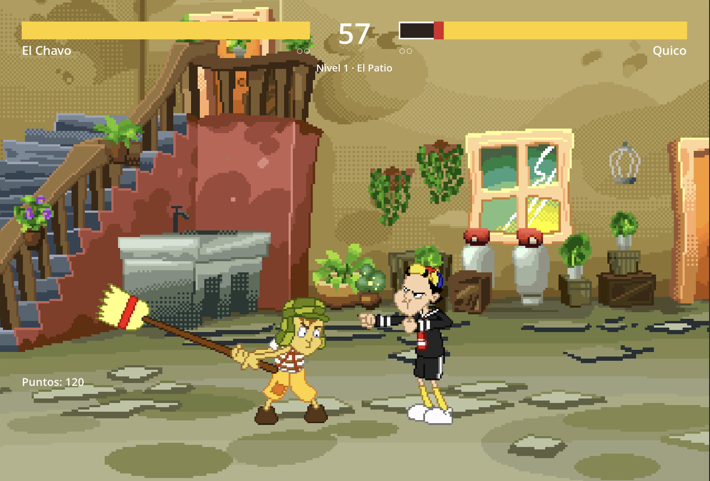

# Pleito en la Vecindad

Juego de peleas 2D estilo *Street Fighter* con los personajes de **El Chavo animado**, hecho en **Godot 4**. Fan game sin fines de lucro.



## Características

- **Modo arcade de 3 niveles**: El Patio (vs. Quico), La Casa de Don Ramón (vs. Don Ramón) y Acapulco (vs. Ñoño), al mejor de 3 rounds.
- **Combate de juego de peleas**: golpe ligero y pesado, ataques agachado y aéreo, bloqueo alto/bajo, hitstun/blockstun, empuje, KO y buffer de entrada.
- **IA por niveles**: máquina de estados (perseguir, atacar, bloquear, retroceder) con tiempo de reacción, agresividad y bloqueo configurables por nivel.
- **Animaciones por contexto**: caminar hacia adelante y atrás, subida y caída del salto, bloqueo de pie y agachado, reacción según el golpe (alto, fuerte, bajo, aéreo, agachado), KO y pose de victoria.
- **Cámara estilo SF**: zoom que sigue a ambos luchadores, con un escenario más ancho que la pantalla y personajes de casi la mitad de su altura.
- **Estaturas reales**: cada personaje tiene su propia altura y hurtbox (Don Ramón es más grande que los niños).
- **Especiales y súpers con comandos** (`↓↘→`, `→↓↘`, `↓↘→↓↘→`...), barra de poder de 3 niveles, proyectiles, ataques de varios golpes y cancelaciones.
- **Datos editables sin código**: personajes, ataques, especiales y niveles son recursos `.tres`.

## Controles

| Acción | Teclado | Mando |
|---|---|---|
| Moverse | `A` / `D` o `←` / `→` | D-pad / stick izquierdo |
| Saltar | `W` o `↑` | D-pad ↑ / `A` |
| Agacharse | `S` o `↓` | D-pad ↓ |
| Golpe ligero | `J` o `Z` | `X` |
| Golpe pesado | `K` o `X` | `Y` |
| Bloquear | `L` o `C` (o mantener "atrás") | `RB` |
| Especial | `I` o `V` | `B` |
| Pausa | `Esc` o `P` | — |

Agachado + golpe = ataque bajo. En el aire + golpe = ataque aéreo. Los ataques **bajos** solo se bloquean agachado.

### Especiales del Chavo

Con el **botón de especial** basta una dirección. Los comandos clásicos también funcionan (escritos mirando a la derecha; si mira a la izquierda se invierten) y con golpe pesado dan la variante fuerte.

| Movimiento | Botón de especial | Comando clásico | Notas |
|---|---|---|---|
| Resortera | Especial | `↓ ↘ →` + golpe | Proyectil; el pesado es más rápido |
| Torta de Jamón | Especial en el aire | `↓ ↘ →` + golpe en el aire | Proyectil en arco hacia abajo |
| Escobazos Giratorios | `→` + Especial | `→ ↓ ↘` + golpe | 3 golpes (4 con pesado), derriba |
| Salto de Lucha Libre | `←` + Especial | `↓ ↙ ←` + golpe | Salta y cae encima: 2 golpes (3 con pesado), derriba |
| Golpazo (agarre) | — | `→` + golpe pesado pegado al rival | No se bloquea, derriba |
| **Súper:** ¡Ahora sí te descalabro los cachetes! | `↓` + Especial | `↓ ↘ → ↓ ↘ →` + golpe | 1 barra, invulnerable al arrancar |
| **Súper:** Combo del Chapulín | `↙` + Especial | `↓ ↙ ← ↓ ↙ ←` + golpe | 1 barra, 5 martillazos, derriba |
| **Súper:** Super Chipote Chillón | `↘` + Especial | `↓ ↘ → ↓ ↘ →` + golpe **pesado** | 2 barras, terremoto (bloquear agachado), derriba |

Si no alcanza la barra, `↘` + Especial hace las trompadas y, sin barra, la Resortera. Los golpes que **derriban** dejan al rival tirado e invulnerable hasta que se levanta.

La **barra de poder** (bajo los nombres, hasta 3 barras) se llena al pegar y al recibir golpes y se conserva entre rounds. Un golpe normal que conecta se puede **cancelar** en un especial o súper.

## Cómo ejecutarlo

1. Instala [Godot 4.7](https://godotengine.org/download) (versión estándar, no .NET).
2. Clona el repositorio:
   ```bash
   git clone https://github.com/elzackarias/fighters.git
   ```
3. Abre `project.godot` desde el gestor de proyectos de Godot y pulsa **F5**.

## Estructura del proyecto

```
assets/sprites/fighters/<id>/   Hojas de sprites originales y su versión sin fondo (*_alpha.png)
resources/
  fighters/<id>/<id>.tres         FighterData: stats, estatura, escala del sprite, ataques
  fighters/<id>/<id>_frames.tres  SpriteFrames con todas las animaciones del personaje
  attacks/                        AttackData: daño, frames, hitbox, empuje, varios golpes, proyectil
  specials/<id>/                  SpecialMoveData: comando, atajo del botón de especial, costo de poder y ataque
  levels/                         LevelData: rival, colores, tiempo, dificultad de la IA
scenes/                           Luchador genérico, arena y pantallas de UI
scripts/
  fighters/fighter.gd             Máquina de estados del luchador (jugador y CPU comparten lógica)
  ai/ai_controller.gd             IA del rival
  levels/fight_arena.gd           Árbitro: rounds, tiempo, cámara, puntaje
  autoload/game_manager.gd        Flujo del juego y controles
tools/                            Recortador de hojas de sprites + configuración por personaje
tests/                            Prueba de humo y capturas
docs/PLAN.md                      Plan de desarrollo por fases
```

## Agregar o cambiar animaciones

Las hojas de sprites tienen fondo de color sólido, con textos y líneas guía. `tools/slice_sheet.py` las procesa:

- quita el fondo y genera un PNG transparente;
- detecta cada frame por componentes conectados, sin cortar escobas ni brazos;
- alinea todos los frames por los pies para que el personaje no "tiemble".

```bash
pip install pillow
python3 tools/slice_sheet.py tools/chavo_sheet.json                 # genera PNG + SpriteFrames
python3 tools/slice_sheet.py tools/chavo_sheet.json --preview /tmp  # + imagen con frames numerados
```

Cada `tools/<id>_sheet.json` define, por animación, en qué hoja y caja está, qué frames usar (`frames`), la velocidad (`speed`) y si hace loop (`loop`). Opciones extra: `boxes` (varias franjas), `anchor: "feet"` (anclar por los pies) y `erase_colors` (borrar líneas guía de un color).

Las animaciones de especiales (`slingshot`, `sandwich_air`, `broom_spin`, `super_cheeks`...) se nombran libremente: cada `AttackData` indica la suya en `animation`.

**Animaciones que reconoce el juego**: `idle`, `walk`, `walk_back`, `jump`, `fall`, `crouch`, `block`, `crouch_block`, `hit`, `hit_hard`, `hit_low`, `hit_air`, `crouch_hit`, `ko`, `victory`, `light_punch`, `heavy_punch`, `crouch_light`, `crouch_heavy` y `air_kick`. Si falta alguna, se usa una de respaldo (por ejemplo `walk_back` → `walk` → `idle`). Si un ataque no tiene animación, se muestra un rectángulo provisional.

## Pruebas

```bash
# Partida completa CPU vs CPU (sin ventana): reporta golpes, bloqueos y animaciones usadas
godot --headless --path . res://tests/smoke_test.tscn

# Detector de comandos (↓↘→, →↓↘...) y especiales con dos luchadores reales
godot --headless --path . -s res://tests/motion_input_test.gd
godot --headless --path . -s res://tests/special_moves_test.gd

# Captura de la arena de un nivel (0-2)
godot --path . res://tests/screenshot.tscn -- 1 captura.png

# Fotogramas de cada especial de Chavo en la arena
godot --path . res://tests/special_capture.tscn -- /tmp/capturas
```

## Estado y próximos pasos

| Personaje | Sprites |
|---|---|
| El Chavo | ✅ |
| Quico | ✅ |
| Don Ramón | ✅ (sin ataques bajos ni aéreo propios: usa el rectángulo provisional) |
| Ñoño | ⏳ placeholder |

Pendiente (ver [`docs/PLAN.md`](docs/PLAN.md)): fondos de escenario, música y efectos de sonido, movimientos especiales (la torta de jamón de Chavo, el coscorrón de Don Ramón...), ajuste fino de hitboxes por personaje e intros de round.

## Créditos y aviso legal

- **Sprites**: Jarquin10, hechos para ToonAlexSora007 / Shimmering Brony, de uso libre para fangames según sus autores.
- **Personajes**: *El Chavo animado* (2006–2014), creado por Roberto Gómez Bolaños "Chespirito", producido por Anima Estudios y Televisa. Los personajes pertenecen a **Grupo Chespirito**.

Este es un proyecto de fans **sin fines de lucro** y no está afiliado ni respaldado por los titulares de los derechos.
